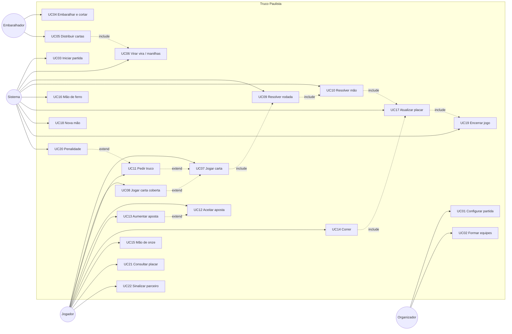
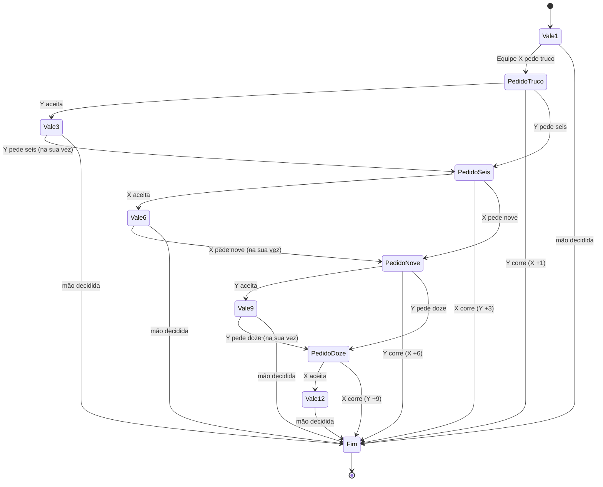

# Especificação de Casos de Uso — Truco Paulista

> Versão 1.0 · Documento de requisitos funcionais
> Escopo: regras do **Truco Paulista** (truco com manilha variável pela "vira"), modeladas como regras de negócio para implementação de um sistema (físico-assistido ou digital).

---

## Sumário

1. [Visão geral](#1-visão-geral)
2. [Atores](#2-atores)
3. [Glossário](#3-glossário)
4. [Regras de negócio](#4-regras-de-negócio)
5. [Lista de casos de uso](#5-lista-de-casos-de-uso)
6. [Diagrama de casos de uso](#6-diagrama-de-casos-de-uso)
7. [Casos de uso detalhados](#7-casos-de-uso-detalhados)
8. [Máquina de estados da aposta](#8-máquina-de-estados-da-aposta)
9. [Variações regionais (parametrizáveis)](#9-variações-regionais-parametrizáveis)
10. [Matriz de rastreabilidade (UC × RN)](#10-matriz-de-rastreabilidade-uc--rn)

---

## 1. Visão geral

O Truco Paulista é um jogo de cartas disputado entre **duas equipes** (1×1 ou 2×2), com baralho de 40 cartas. Cada **mão** é disputada em até **três rodadas**; vence a mão a equipe que ganhar duas rodadas. Durante a mão, as equipes podem **apostar** (truco, seis, nove, doze), aumentando o valor em pontos. Vence o **jogo** a primeira equipe a atingir **12 pontos**.

A característica que define o Truco Paulista é a **manilha variável**: após a distribuição, uma carta é virada (a **vira**) e as quatro cartas do valor imediatamente superior tornam-se as manilhas daquela mão.

---

## 2. Atores

| Ator | Descrição |
|---|---|
| **Jogador** | Participante que recebe cartas, joga, pede e responde apostas. Pertence a uma equipe. |
| **Embaralhador ("pé")** | Jogador que, na mão corrente, embaralha e distribui as cartas. Papel rotativo. |
| **Cortador** | Jogador responsável por cortar o baralho antes da distribuição. |
| **Jogador "mão"** | Jogador à direita do embaralhador; inicia a primeira rodada da mão. |
| **Equipe (Dupla)** | Conjunto de jogadores que somam pontos juntos. Em 1×1, a equipe tem um jogador. |
| **Sistema (Juiz/Mesa)** | Ator secundário que valida jogadas, resolve rodadas, controla apostas e o placar. |
| **Organizador** | Quem cria e configura a partida (pode ser um dos jogadores). |

---

## 3. Glossário

| Termo | Significado |
|---|---|
| **Partida / Jogo** | Disputa até uma equipe atingir 12 pontos. |
| **Queda** | Conjunto de jogos (normalmente melhor de 3). Opcional. |
| **Mão** | Ciclo de distribuição de 3 cartas a cada jogador, disputado em até 3 rodadas. |
| **Rodada (vaza)** | Cada jogador joga uma carta; a maior vence a rodada. |
| **Vira** | Carta virada após a distribuição; define a manilha. Não pertence a nenhum jogador. |
| **Manilha** | As 4 cartas do valor imediatamente acima da vira; são as mais fortes da mão. |
| **Zap** | Manilha de Paus (a mais forte). |
| **Copas** | Manilha de Copas (2ª mais forte). |
| **Espadilha** | Manilha de Espadas (3ª mais forte). |
| **Pica-fumo** | Manilha de Ouros (4ª mais forte). |
| **Cangar / Empachar** | Empatar uma rodada. |
| **Carta coberta (encoberta)** | Carta jogada virada para baixo; não tem valor. |
| **Truco / Seis / Nove / Doze** | Pedidos de aumento do valor da mão. |
| **Correr** | Recusar uma aposta (ou desistir da mão), entregando os pontos ao adversário. |
| **Mão de onze** | Mão em que uma equipe tem 11 pontos. |
| **Mão de ferro** | Mão em que ambas as equipes têm 11 pontos. |

---

## 4. Regras de negócio

### 4.1 Baralho e cartas

| ID | Regra |
|---|---|
| **RN01** | O baralho tem **40 cartas**: retiram-se os 8, 9, 10 e coringas de um baralho comum. |
| **RN02** | Ordem de força das **cartas comuns** (da mais forte para a mais fraca): **3 > 2 > A > K > J > Q > 7 > 6 > 5 > 4**. |
| **RN03** | Entre cartas comuns de mesmo valor, o **naipe não desempata**: as cartas são equivalentes. |
| **RN04** | Após a distribuição, a carta do topo do monte é virada e torna-se a **vira**. A vira não é jogável e não pertence a ninguém. |
| **RN05** | A **manilha** é o valor imediatamente acima da vira na sequência cíclica **4 → 5 → 6 → 7 → Q → J → K → A → 2 → 3 → 4**. (Ver tabela 4.1.1.) |
| **RN06** | Ordem de força entre manilhas, por naipe: **Paus (Zap) > Copas > Espadas (Espadilha) > Ouros (Pica-fumo)**. |
| **RN07** | Qualquer manilha vence qualquer carta comum. Duas manilhas nunca empatam (naipes distintos). |
| **RN08** | Nas mãos em que um valor vira manilha, esse valor sai da sequência de cartas comuns; os demais mantêm a ordem relativa da RN02. |

#### 4.1.1 Tabela vira → manilha

| Vira | 4 | 5 | 6 | 7 | Q | J | K | A | 2 | 3 |
|---|---|---|---|---|---|---|---|---|---|---|
| **Manilha** | 5 | 6 | 7 | Q | J | K | A | 2 | 3 | 4 |

### 4.2 Jogadores, posições e preparação

| ID | Regra |
|---|---|
| **RN09** | A partida tem **2 jogadores (1×1)** ou **4 jogadores (2×2)**. |
| **RN10** | Em 2×2, parceiros sentam **frente a frente**, alternando equipes ao redor da mesa. |
| **RN11** | O sentido do jogo (distribuição, ordem de jogada e rotação do embaralhador) é **anti-horário**. |
| **RN12** | O primeiro embaralhador da partida é definido por **sorteio**. |
| **RN13** | A cada nova mão, o papel de embaralhador passa para o jogador **à direita** do embaralhador anterior. |
| **RN14** | O baralho é **cortado** pelo jogador à esquerda do embaralhador antes da distribuição. |
| **RN15** | Cada jogador recebe **3 cartas**, distribuídas no sentido anti-horário, começando pelo jogador à direita do embaralhador. |
| **RN16** | As cartas de cada jogador são **secretas**; um jogador não pode ver as cartas de outro (exceção: RN35). |

### 4.3 Rodadas e mão

| ID | Regra |
|---|---|
| **RN17** | A primeira rodada é iniciada pelo jogador **"mão"** (à direita do embaralhador). |
| **RN18** | Cada jogador joga **uma carta por rodada**, na sua vez, em sentido anti-horário. Não é permitido jogar fora da vez. |
| **RN19** | Carta jogada **não pode ser retirada** nem trocada. |
| **RN20** | Vence a rodada a equipe que jogou a **carta mais forte** (RN02, RN06, RN07). |
| **RN21** | Se as cartas mais fortes empatadas pertencem à **mesma equipe** (2×2), essa equipe vence a rodada (não há empate). |
| **RN22** | Há **empate (cangou)** quando as cartas mais fortes de mesmo valor pertencem a **equipes diferentes**. |
| **RN23** | O jogador que venceu a rodada **inicia a próxima**. Em caso de empate, inicia a próxima o jogador que iniciou a rodada empatada *(parametrizável, ver seção 9)*. |
| **RN24** | Vence a mão a equipe que vencer **2 rodadas**. Se a mão estiver decidida após 2 rodadas, a 3ª **não é jogada**. |
| **RN25** | **Regras de empate:**  a) 1ª empatada → vence a mão quem vencer a 2ª;  b) 1ª e 2ª empatadas → vence quem vencer a 3ª;  c) 1ª vencida por X e 2ª empatada → **X vence a mão**;  d) 1ª vencida por X, 2ª por Y e 3ª empatada → **X vence a mão** (quem fez a primeira);  e) as 3 empatadas → **ninguém pontua** na mão. |
| **RN26** | **Carta coberta:** a partir da **2ª rodada**, o jogador pode jogar uma carta virada para baixo. Ela **não tem valor** e perde para qualquer carta. Não é permitido cobrir na 1ª rodada. |

### 4.4 Pontuação e apostas

| ID | Regra |
|---|---|
| **RN27** | Uma mão sem apostas vale **1 ponto**. |
| **RN28** | Escada de apostas: **Truco = 3**, **Seis = 6**, **Nove = 9**, **Doze = 12**. Não há aumento além de 12. |
| **RN29** | O pedido de aposta só pode ser feito pelo jogador **na sua vez**, antes de jogar sua carta, e enquanto a mão estiver em andamento. |
| **RN30** | Após um pedido, o jogo **pausa** até a equipe desafiada responder. Qualquer integrante da equipe desafiada pode responder; vale a primeira resposta. |
| **RN31** | Respostas possíveis: **Aceitar** (a mão passa a valer o valor pedido), **Correr** (recusa) ou **Aumentar** (aceita implicitamente e pede o próximo degrau). |
| **RN32** | **Alternância:** a equipe que fez o último pedido **não pode** fazer o próximo aumento; só a equipe adversária pode aumentar. |
| **RN33** | Ao **correr** de um pedido, a equipe adversária ganha o **valor vigente antes do pedido** (ex.: correr do truco = 1 ponto; correr do seis = 3; correr do nove = 6; correr do doze = 9). A mão termina imediatamente. |
| **RN34** | Uma equipe pode **desistir da mão** (correr) na sua vez, mesmo sem pedido pendente; a adversária ganha o valor vigente da mão. |

### 4.5 Situações especiais e fim de jogo

| ID | Regra |
|---|---|
| **RN35** | **Mão de onze:** quando apenas uma equipe tem **11 pontos**, seus integrantes podem **ver as cartas do parceiro** e decidir **jogar** ou **correr** antes da 1ª rodada. |
| **RN36** | Na mão de onze, se a equipe com 11 **jogar**, a mão vale **3 pontos**; se **correr**, a adversária ganha **1 ponto**. |
| **RN37** | Na mão de onze **nenhuma equipe pode pedir truco** (nem aumentos). Pedido feito é infração: a equipe infratora **perde a mão** e a adversária recebe 3 pontos *(parametrizável: perder o jogo)*. |
| **RN38** | **Mão de ferro:** quando **ambas** as equipes têm **11 pontos**, as cartas são jogadas **às cegas** (ninguém vê as próprias cartas), não há apostas e quem vencer a mão **vence o jogo**. |
| **RN39** | Vence o jogo a primeira equipe a atingir **12 pontos ou mais**. Pontos excedentes são desconsiderados. |
| **RN40** | O placar só é atualizado ao **fim de cada mão** (ou quando uma equipe corre). |
| **RN41** | *(Opcional)* **Queda:** uma série de jogos em **melhor de 3**; vence a queda quem vencer 2 jogos. |
| **RN42** | Parceiros podem trocar **sinais** convencionais sobre as cartas; não é permitido mostrar cartas ou falar explicitamente o que se tem (exceto RN35). |

---

## 5. Lista de casos de uso

| ID | Caso de uso | Ator principal |
|---|---|---|
| UC01 | Configurar partida | Organizador |
| UC02 | Formar equipes e definir posições | Organizador / Jogadores |
| UC03 | Iniciar partida | Sistema |
| UC04 | Embaralhar e cortar | Embaralhador / Cortador |
| UC05 | Distribuir cartas | Embaralhador |
| UC06 | Virar a vira e definir manilhas | Sistema |
| UC07 | Jogar carta | Jogador |
| UC08 | Jogar carta coberta | Jogador |
| UC09 | Resolver rodada | Sistema |
| UC10 | Resolver mão | Sistema |
| UC11 | Pedir truco | Jogador |
| UC12 | Responder pedido de aposta (aceitar) | Jogador |
| UC13 | Aumentar aposta (seis / nove / doze) | Jogador |
| UC14 | Correr (recusar aposta ou desistir da mão) | Jogador |
| UC15 | Decidir mão de onze | Equipe com 11 pontos |
| UC16 | Jogar mão de ferro | Jogadores / Sistema |
| UC17 | Atualizar placar | Sistema |
| UC18 | Iniciar nova mão (passar o pé) | Sistema |
| UC19 | Encerrar jogo / queda | Sistema |
| UC20 | Aplicar penalidade por infração | Sistema |
| UC21 | Consultar placar e histórico | Jogador |
| UC22 | Sinalizar ao parceiro | Jogador |

---

## 6. Diagrama de casos de uso

---

## 7. Casos de uso detalhados

### UC01 — Configurar partida

| Campo | Descrição |
|---|---|
| **Ator principal** | Organizador |
| **Objetivo** | Definir os parâmetros da partida. |
| **Pré-condições** | Nenhuma partida em andamento para a mesa. |
| **Gatilho** | Organizador solicita a criação de uma partida. |
| **RN relacionadas** | RN09, RN37, RN41, seção 9 |

**Fluxo principal**
1. Organizador solicita nova partida.
2. Sistema apresenta os modos: **1×1** ou **2×2**.
3. Organizador escolhe o modo.
4. Sistema apresenta os parâmetros opcionais (queda melhor de 3, penalidade de truco na mão de onze, regra de início após empate).
5. Organizador confirma.
6. Sistema cria a partida com placar 0 × 0 e estado *Aguardando jogadores*.

**Fluxos alternativos**
- **A1 — Usar padrão:** no passo 4, Organizador aceita os parâmetros padrão; segue ao passo 6.

**Exceções**
- **E1 — Modo inválido:** número de jogadores diferente de 2 ou 4 → sistema rejeita (RN09).

**Pós-condições**: partida criada e configurada.

---

### UC02 — Formar equipes e definir posições

| Campo | Descrição |
|---|---|
| **Ator principal** | Organizador / Jogadores |
| **Pré-condições** | Partida criada (UC01). |
| **RN relacionadas** | RN09, RN10, RN11 |

**Fluxo principal**
1. Jogadores entram na mesa.
2. Sistema atribui cada jogador a uma equipe (Equipe A / Equipe B).
3. Em 2×2, sistema posiciona parceiros **frente a frente**, alternando equipes (A1, B1, A2, B2 no sentido anti-horário).
4. Sistema confirma as posições e muda o estado para *Pronta para iniciar*.

**Fluxos alternativos**
- **A1 — Escolha de parceiro:** jogadores escolhem seus parceiros; sistema posiciona conforme RN10.
- **A2 — Sorteio de equipes:** sistema sorteia as equipes.

**Exceções**
- **E1 — Mesa incompleta:** faltam jogadores → partida permanece em *Aguardando jogadores*.
- **E2 — Equipes desbalanceadas:** sistema rejeita formação com equipes de tamanhos diferentes.

**Pós-condições**: equipes e posições definidas.

---

### UC03 — Iniciar partida

| Campo | Descrição |
|---|---|
| **Ator principal** | Sistema |
| **Pré-condições** | Mesa completa, equipes formadas (UC02). |
| **RN relacionadas** | RN12, RN01 |

**Fluxo principal**
1. Sistema monta o baralho de 40 cartas (RN01).
2. Sistema **sorteia** o primeiro embaralhador (RN12).
3. Sistema zera o placar e define o estado da partida como *Em andamento*.
4. Sistema aciona **UC04**.

**Pós-condições**: partida em andamento, primeiro embaralhador definido.

---

### UC04 — Embaralhar e cortar

| Campo | Descrição |
|---|---|
| **Ator principal** | Embaralhador; Cortador (secundário) |
| **Pré-condições** | Início de uma nova mão. |
| **RN relacionadas** | RN01, RN14 |

**Fluxo principal**
1. Embaralhador recolhe todas as cartas (40).
2. Embaralhador embaralha.
3. Sistema solicita o corte ao jogador **à esquerda** do embaralhador (RN14).
4. Cortador corta o baralho.
5. Sistema aciona **UC05**.

**Fluxos alternativos**
- **A1 — Corte dispensado:** cortador opta por não cortar ("bate na mesa"); segue o passo 5.

**Exceções**
- **E1 — Baralho incompleto:** quantidade ≠ 40 → sistema impede a distribuição e solicita recomposição.

**Pós-condições**: baralho embaralhado e cortado.

---

### UC05 — Distribuir cartas

| Campo | Descrição |
|---|---|
| **Ator principal** | Embaralhador |
| **Pré-condições** | Baralho embaralhado e cortado (UC04). |
| **RN relacionadas** | RN11, RN15, RN16, RN38 |

**Fluxo principal**
1. Embaralhador entrega **3 cartas** a cada jogador, em sentido anti-horário, começando pelo jogador à sua direita (RN15).
2. Cada jogador recebe suas cartas de forma secreta (RN16).
3. Sistema aciona **UC06**.

**Fluxos alternativos**
- **A1 — Mão de ferro:** se o placar for 11 × 11, as cartas são entregues **viradas para baixo** e os jogadores **não podem vê-las** (RN38) → ver UC16.

**Exceções**
- **E1 — Erro na distribuição** (carta exposta ou quantidade errada): mão é anulada e redistribuída pelo mesmo embaralhador.

**Pós-condições**: cada jogador com 3 cartas.

---

### UC06 — Virar a vira e definir manilhas

| Campo | Descrição |
|---|---|
| **Ator principal** | Sistema |
| **Pré-condições** | Cartas distribuídas (UC05). |
| **RN relacionadas** | RN04, RN05, RN06, RN08 |

**Fluxo principal**
1. Sistema vira a carta do topo do monte restante (**vira**) e a expõe na mesa (RN04).
2. Sistema calcula o valor da **manilha** pela sequência cíclica (RN05, tabela 4.1.1).
3. Sistema monta a hierarquia de força da mão: manilhas (Zap > Copas > Espadilha > Pica-fumo) acima das cartas comuns (RN06, RN07, RN08).
4. Sistema verifica o placar:
   - Se uma equipe tem 11 → aciona **UC15**.
   - Se ambas têm 11 → aciona **UC16**.
   - Caso contrário → libera a 1ª rodada para o jogador "mão" (RN17).

**Pós-condições**: vira exposta, manilhas definidas, hierarquia da mão estabelecida, valor da mão = 1 (RN27).

---

### UC07 — Jogar carta

| Campo | Descrição |
|---|---|
| **Ator principal** | Jogador |
| **Pré-condições** | É a vez do jogador; não há pedido de aposta pendente; mão em andamento. |
| **RN relacionadas** | RN18, RN19, RN23, RN29 |

**Fluxo principal**
1. Sistema indica que é a vez do jogador.
2. Jogador escolhe uma de suas cartas.
3. Jogador coloca a carta na mesa, virada para cima.
4. Sistema registra a carta como jogada na rodada corrente (RN19).
5. Se ainda há jogadores a jogar na rodada, sistema passa a vez ao próximo (anti-horário).
6. Se todos jogaram, sistema aciona **UC09**.

**Fluxos alternativos**
- **A1 — Pedir truco antes de jogar:** antes do passo 2, jogador aciona **UC11**.
- **A2 — Jogar coberta:** no passo 3, jogador aciona **UC08**.
- **A3 — Desistir:** antes do passo 2, jogador aciona **UC14** (desistência).

**Exceções**
- **E1 — Fora da vez:** sistema rejeita a jogada (RN18) e pode acionar **UC20**.
- **E2 — Pedido pendente:** sistema bloqueia a jogada até a resposta (RN30).
- **E3 — Carta inexistente na mão do jogador:** sistema rejeita.

**Pós-condições**: carta registrada na rodada; vez passada ou rodada resolvida.

---

### UC08 — Jogar carta coberta

| Campo | Descrição |
|---|---|
| **Ator principal** | Jogador |
| **Pré-condições** | Mesmas do UC07 e **rodada corrente ≥ 2**. |
| **RN relacionadas** | RN26 |

**Fluxo principal**
1. Jogador escolhe uma carta e indica que vai jogá-la **coberta**.
2. Sistema valida que não é a 1ª rodada.
3. Sistema registra a carta com **valor nulo** (perde para qualquer carta).
4. Fluxo continua no passo 5 do UC07.

**Exceções**
- **E1 — 1ª rodada:** sistema rejeita a jogada coberta (RN26); jogador deve jogar aberta.

**Pós-condições**: carta registrada como coberta; seu valor não é revelado aos adversários.

---

### UC09 — Resolver rodada

| Campo | Descrição |
|---|---|
| **Ator principal** | Sistema |
| **Pré-condições** | Todos os jogadores jogaram na rodada. |
| **RN relacionadas** | RN02, RN03, RN06, RN07, RN20, RN21, RN22, RN23, RN26 |

**Fluxo principal**
1. Sistema compara as cartas jogadas conforme a hierarquia da mão (manilhas > comuns; cobertas sem valor).
2. Sistema identifica a carta mais forte.
3. Sistema atribui a rodada à equipe que jogou a carta mais forte (RN20).
4. Sistema define que o jogador vencedor inicia a próxima rodada (RN23).
5. Sistema aciona **UC10** para verificar se a mão está decidida.

**Fluxos alternativos**
- **A1 — Empate entre parceiros (2×2):** as maiores cartas de mesmo valor são da mesma equipe → equipe vence a rodada (RN21).
- **A2 — Empate entre equipes (cangou):** as maiores cartas de mesmo valor são de equipes diferentes → rodada registrada como **empate** (RN22); próximo a iniciar conforme RN23.

**Pós-condições**: resultado da rodada registrado (vitória A, vitória B ou empate).

---

### UC10 — Resolver mão

| Campo | Descrição |
|---|---|
| **Ator principal** | Sistema |
| **Pré-condições** | Ao menos uma rodada resolvida. |
| **RN relacionadas** | RN24, RN25, RN27, RN28 |

**Fluxo principal**
1. Sistema avalia os resultados das rodadas da mão.
2. Se uma equipe venceu **2 rodadas**, ela vence a mão (RN24).
3. Sistema aplica as regras de empate (RN25):
   - 1ª empatada → vencedor da 2ª leva a mão;
   - 1ª e 2ª empatadas → vencedor da 3ª leva;
   - 1ª vencida e 2ª empatada → quem venceu a 1ª leva;
   - 3ª empatada após 1×1 → quem venceu a 1ª leva;
   - 3 empatadas → ninguém pontua.
4. Se a mão está decidida, sistema aciona **UC17** com o valor vigente da mão (1, 3, 6, 9 ou 12).
5. Se não está decidida, sistema libera a próxima rodada.

**Fluxos alternativos**
- **A1 — Decidida na 2ª rodada:** a 3ª rodada não é jogada; cartas restantes são descartadas sem revelar (RN24).
- **A2 — Três empates:** nenhuma pontuação; sistema aciona **UC18**.

**Pós-condições**: vencedor da mão determinado (ou mão sem pontos).

---

### UC11 — Pedir truco

| Campo | Descrição |
|---|---|
| **Ator principal** | Jogador |
| **Pré-condições** | É a vez do jogador; mão em andamento; valor atual da mão = 1; não é mão de onze nem mão de ferro. |
| **RN relacionadas** | RN28, RN29, RN30, RN37, RN38 |

**Fluxo principal**
1. Jogador anuncia **"Truco!"** antes de jogar sua carta.
2. Sistema valida o pedido (vez do jogador, valor atual = 1, situação permite apostas).
3. Sistema registra o pedido (valor proposto = 3) e **pausa** o jogo (RN30).
4. Sistema notifica a equipe adversária para responder (UC12, UC13 ou UC14).
5. Após aceitação, o jogador que pediu prossegue com a jogada (UC07).

**Exceções**
- **E1 — Fora da vez:** pedido rejeitado (RN29).
- **E2 — Mão de onze:** pedido configura infração → **UC20** (RN37).
- **E3 — Mão de ferro:** pedido rejeitado (RN38).
- **E4 — Mão já trucada:** o próximo pedido só pode ser aumento pela outra equipe (UC13).

**Pós-condições**: pedido pendente de resposta.

---

### UC12 — Responder pedido de aposta (aceitar)

| Campo | Descrição |
|---|---|
| **Ator principal** | Jogador da equipe desafiada |
| **Pré-condições** | Existe pedido de aposta pendente contra sua equipe. |
| **RN relacionadas** | RN30, RN31, RN32 |

**Fluxo principal**
1. Sistema apresenta o pedido à equipe desafiada.
2. Um jogador da equipe responde **"Aceito" / "Desce"**.
3. Sistema atualiza o valor da mão para o valor pedido (3, 6, 9 ou 12).
4. Sistema registra que a **próxima** possibilidade de aumento pertence à equipe que aceitou (RN32).
5. Sistema despausa o jogo; a vez retorna a quem estava jogando.

**Fluxos alternativos**
- **A1 — Aumentar:** no passo 2, jogador responde com aumento → **UC13**.
- **A2 — Correr:** no passo 2, jogador responde correndo → **UC14**.
- **A3 — Respostas simultâneas dos parceiros:** sistema considera a **primeira resposta recebida** (RN30).

**Pós-condições**: valor da mão atualizado; jogo retomado.

---

### UC13 — Aumentar aposta (seis / nove / doze)

| Campo | Descrição |
|---|---|
| **Ator principal** | Jogador |
| **Pré-condições** | (a) Há pedido pendente contra sua equipe, **ou** (b) é a vez do jogador e sua equipe foi a última a **aceitar** uma aposta. Valor atual < 12. |
| **RN relacionadas** | RN28, RN31, RN32 |

**Fluxo principal**
1. Jogador anuncia o próximo degrau: **Seis** (após truco), **Nove** (após seis) ou **Doze** (após nove).
2. Sistema valida a alternância: a equipe que fez o último pedido não pode aumentar (RN32).
3. Se havia pedido pendente, sistema considera o pedido anterior **aceito** implicitamente (RN31).
4. Sistema registra o novo pedido e pausa o jogo.
5. Sistema notifica a outra equipe para responder (UC12, UC13 ou UC14).

**Exceções**
- **E1 — Valor máximo:** valor atual = 12 → aumento rejeitado (RN28).
- **E2 — Mesma equipe:** equipe que fez o último pedido tenta aumentar → rejeitado (RN32).
- **E3 — Pulo de degrau:** pedido que não seja o próximo degrau é rejeitado.

**Pós-condições**: novo pedido pendente com valor superior.

---

### UC14 — Correr (recusar aposta ou desistir da mão)

| Campo | Descrição |
|---|---|
| **Ator principal** | Jogador |
| **Pré-condições** | Pedido pendente contra a equipe **ou** é a vez do jogador. |
| **RN relacionadas** | RN33, RN34, RN36 |

**Fluxo principal (recusar aposta)**
1. Jogador da equipe desafiada responde **"Corro"**.
2. Sistema encerra a mão imediatamente.
3. Sistema atribui à equipe adversária o **valor vigente antes do pedido** (RN33):

| Pedido recusado | Pontos para quem pediu |
|---|---|
| Truco (3) | 1 |
| Seis (6) | 3 |
| Nove (9) | 6 |
| Doze (12) | 9 |

4. Sistema aciona **UC17**.

**Fluxos alternativos**
- **A1 — Desistência sem pedido:** na sua vez, jogador desiste da mão; adversária recebe o **valor vigente** da mão (RN34).
- **A2 — Correr na mão de onze:** ver UC15 (adversária recebe 1 ponto).

**Pós-condições**: mão encerrada e pontos atribuídos.

---

### UC15 — Decidir mão de onze

| Campo | Descrição |
|---|---|
| **Ator principal** | Equipe com 11 pontos |
| **Pré-condições** | Exatamente uma equipe com 11 pontos; cartas distribuídas e vira exposta. |
| **RN relacionadas** | RN35, RN36, RN37 |

**Fluxo principal**
1. Sistema identifica a mão de onze e bloqueia pedidos de aposta para ambas as equipes (RN37).
2. Sistema permite que os integrantes da equipe com 11 **vejam as cartas do parceiro** (RN35).
3. Equipe decide **jogar** ou **correr**.
4. Se jogar: sistema define o valor da mão como **3 pontos** e libera a 1ª rodada (RN36).
5. A mão segue normalmente (UC07–UC10), sem apostas.

**Fluxos alternativos**
- **A1 — Correr:** a equipe adversária recebe **1 ponto**; mão encerrada; sistema aciona UC17 (RN36).
- **A2 — Divergência entre parceiros:** sistema exige decisão única da equipe (ex.: prevalece a decisão do jogador "mão" da equipe ou consenso, conforme configuração).

**Exceções**
- **E1 — Pedido de truco durante a mão de onze:** sistema aciona **UC20** (RN37).

**Pós-condições**: mão de onze jogada (vale 3) ou encerrada com 1 ponto ao adversário.

---

### UC16 — Jogar mão de ferro

| Campo | Descrição |
|---|---|
| **Ator principal** | Jogadores / Sistema |
| **Pré-condições** | Placar 11 × 11. |
| **RN relacionadas** | RN38, RN39 |

**Fluxo principal**
1. Sistema identifica a mão de ferro.
2. Cartas são distribuídas viradas para baixo; **nenhum jogador vê suas cartas** (RN38).
3. Sistema bloqueia pedidos de aposta e desistências.
4. Em cada rodada, cada jogador escolhe uma carta às cegas e a revela ao jogar.
5. Sistema resolve rodadas e mão normalmente (UC09, UC10).
6. A equipe vencedora da mão **vence o jogo** → UC19.

**Fluxos alternativos**
- **A1 — Três empates:** ninguém pontua; nova mão de ferro é distribuída (UC18).

**Pós-condições**: jogo encerrado com vencedor.

---

### UC17 — Atualizar placar

| Campo | Descrição |
|---|---|
| **Ator principal** | Sistema |
| **Pré-condições** | Mão encerrada (UC10, UC14, UC15 ou UC20). |
| **RN relacionadas** | RN39, RN40 |

**Fluxo principal**
1. Sistema soma os pontos da mão à equipe vencedora.
2. Sistema limita a exibição a 12 pontos (pontos excedentes desconsiderados — RN39).
3. Sistema registra a mão no histórico (vira, manilha, cartas jogadas, apostas, vencedor, pontos).
4. Se alguma equipe atingiu 12 → aciona **UC19**.
5. Caso contrário → aciona **UC18**.

**Pós-condições**: placar atualizado e histórico registrado.

---

### UC18 — Iniciar nova mão (passar o pé)

| Campo | Descrição |
|---|---|
| **Ator principal** | Sistema |
| **Pré-condições** | Mão anterior encerrada; jogo não terminado. |
| **RN relacionadas** | RN13, RN17 |

**Fluxo principal**
1. Sistema recolhe todas as cartas e a vira.
2. Sistema passa o papel de embaralhador ao jogador **à direita** do anterior (RN13).
3. Sistema redefine: valor da mão = 1, nenhum pedido pendente, rodadas zeradas.
4. Sistema aciona **UC04**.

**Pós-condições**: nova mão pronta para embaralhar.

---

### UC19 — Encerrar jogo / queda

| Campo | Descrição |
|---|---|
| **Ator principal** | Sistema |
| **Pré-condições** | Uma equipe atingiu 12 pontos (ou venceu a mão de ferro). |
| **RN relacionadas** | RN39, RN41 |

**Fluxo principal**
1. Sistema declara a equipe vencedora do jogo.
2. Sistema registra o resultado.
3. Se a partida é em **jogo único**, sistema encerra a partida.

**Fluxos alternativos**
- **A1 — Queda (melhor de 3):** sistema incrementa a contagem de jogos vencidos. Se uma equipe venceu 2 jogos, encerra a queda; caso contrário, zera o placar e inicia novo jogo (UC18) (RN41).
- **A2 — Revanche:** jogadores solicitam nova partida com as mesmas equipes → UC03.

**Pós-condições**: jogo (ou queda) finalizado com vencedor registrado.

---

### UC20 — Aplicar penalidade por infração

| Campo | Descrição |
|---|---|
| **Ator principal** | Sistema |
| **Pré-condições** | Detecção de jogada ilegal. |
| **RN relacionadas** | RN16, RN18, RN26, RN37 |

**Fluxo principal**
1. Sistema detecta a infração.
2. Sistema aplica a penalidade correspondente:

| Infração | Penalidade padrão |
|---|---|
| Pedir truco na mão de onze (RN37) | Equipe infratora perde a mão; adversária recebe 3 pontos *(parametrizável: perde o jogo)* |
| Jogar fora da vez (RN18) | Jogada anulada (em sistema digital, simplesmente bloqueada) |
| Jogar coberta na 1ª rodada (RN26) | Jogada anulada; carta deve ser jogada aberta |
| Mostrar cartas ao parceiro fora da mão de onze (RN16) | Equipe infratora perde a mão (valor vigente para a adversária) |

3. Sistema registra a infração no histórico.
4. Se a penalidade encerra a mão, aciona **UC17**.

**Pós-condições**: infração tratada e registrada.

---

### UC21 — Consultar placar e histórico

| Campo | Descrição |
|---|---|
| **Ator principal** | Jogador |
| **Pré-condições** | Partida criada. |

**Fluxo principal**
1. Jogador solicita o placar.
2. Sistema exibe: pontos de cada equipe, valor atual da mão, vira e manilha, rodadas da mão corrente, quem está na vez, embaralhador atual e (se houver) jogos da queda.
3. Opcionalmente, jogador consulta o histórico de mãos anteriores.

**Regra:** o histórico nunca revela cartas cobertas ou não jogadas de outros jogadores durante a mão em andamento (RN16).

---

### UC22 — Sinalizar ao parceiro

| Campo | Descrição |
|---|---|
| **Ator principal** | Jogador (modo 2×2) |
| **Pré-condições** | Mão em andamento; partida 2×2. |
| **RN relacionadas** | RN42 |

**Fluxo principal**
1. Jogador envia um sinal convencionado ao parceiro (ex.: piscada = Zap, ombro = Copas, sobrancelha = Espadilha, boca torta = Pica-fumo, olhar fixo = 3).
2. Em sistema digital: sistema entrega o sinal **apenas ao parceiro**, com possibilidade configurável de "ser visto" pelos adversários (simulando a vigilância da mesa).

**Exceções**
- **E1 — Revelação explícita** (mostrar carta / dizer a carta): infração → UC20.

---

## 8. Máquina de estados da aposta

> Em `Vale1`, qualquer equipe pode pedir truco. A partir de `Vale3`, apenas a equipe que **aceitou** o último pedido pode aumentar (RN32).

---

## 9. Variações regionais (parametrizáveis)

O Truco Paulista tem variações entre grupos de jogadores. Recomenda-se tratá-las como **parâmetros de configuração** da partida:

| Parâmetro | Padrão deste documento | Alternativas comuns |
|---|---|---|
| Quem inicia após empate | Quem iniciou a rodada empatada | Quem jogou a carta empatante mais alta primeiro; o jogador "mão" |
| Penalidade por truco na mão de onze | Perde a mão (+3 adversário) | Perde o jogo |
| Decisão na mão de onze (2×2) | Decisão única da equipe | Prevalece o jogador "mão" da equipe |
| Carta coberta | Permitida a partir da 2ª rodada | Proibida |
| Distribuição | 3 cartas por jogador, uma a uma | 3 cartas de uma vez por jogador |
| Queda | Jogo único | Melhor de 3 |
| Modo 3×3 (6 jogadores) | Não suportado | Suportado, mantendo alternância de equipes |
| Mão de ferro | Às cegas, vale o jogo | Jogada normal, vale 1 ponto |

---

## 10. Matriz de rastreabilidade (UC × RN)

| UC | Regras de negócio |
|---|---|
| UC01 | RN09, RN37, RN41 |
| UC02 | RN09, RN10, RN11 |
| UC03 | RN01, RN12 |
| UC04 | RN01, RN14 |
| UC05 | RN11, RN15, RN16, RN38 |
| UC06 | RN04, RN05, RN06, RN07, RN08, RN17, RN27 |
| UC07 | RN18, RN19, RN23, RN29, RN30 |
| UC08 | RN26 |
| UC09 | RN02, RN03, RN06, RN07, RN20, RN21, RN22, RN23 |
| UC10 | RN24, RN25, RN27, RN28 |
| UC11 | RN28, RN29, RN30, RN37, RN38 |
| UC12 | RN30, RN31, RN32 |
| UC13 | RN28, RN31, RN32 |
| UC14 | RN33, RN34, RN36 |
| UC15 | RN35, RN36, RN37 |
| UC16 | RN38, RN39 |
| UC17 | RN39, RN40 |
| UC18 | RN13, RN17, RN27 |
| UC19 | RN39, RN41 |
| UC20 | RN16, RN18, RN26, RN37 |
| UC21 | RN16 |
| UC22 | RN42 |